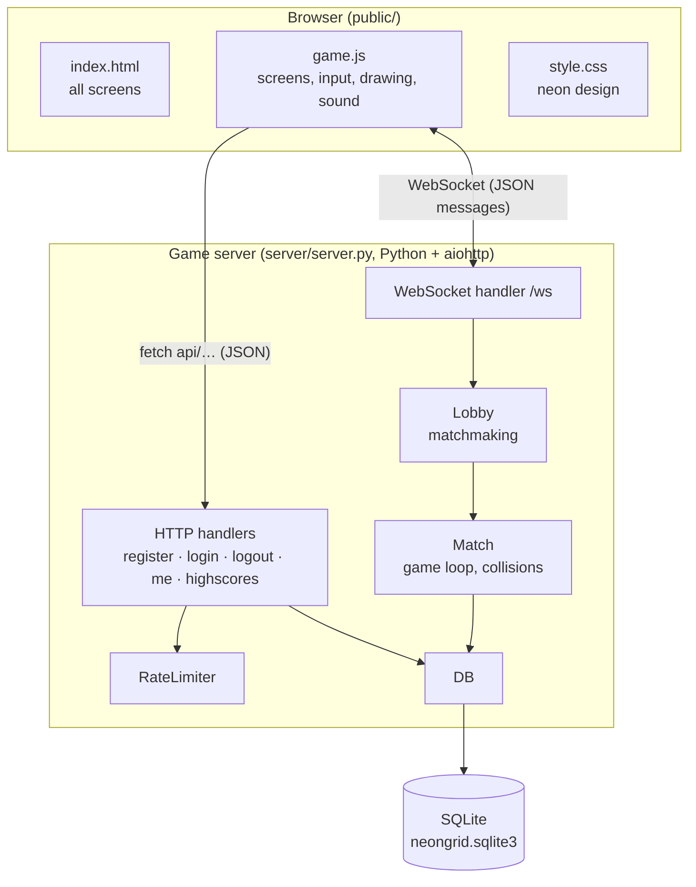
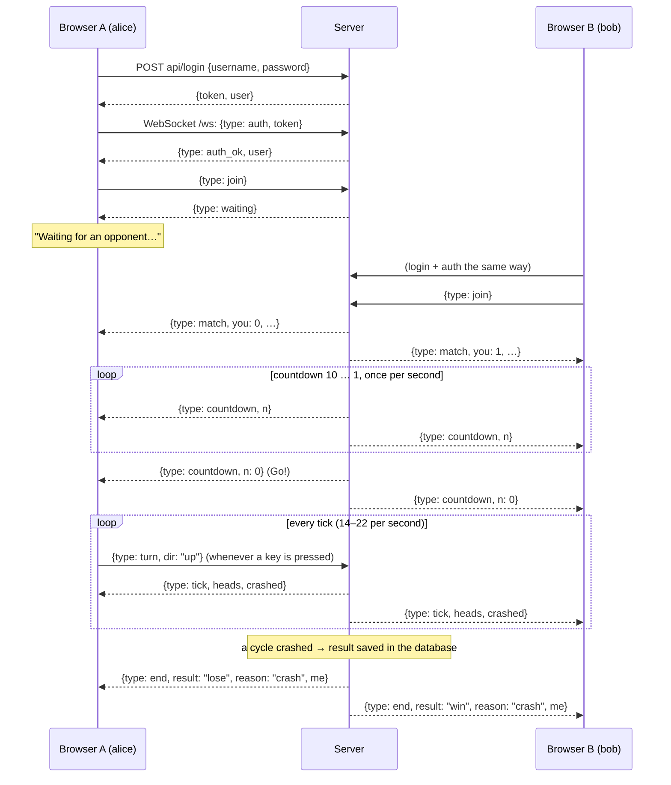
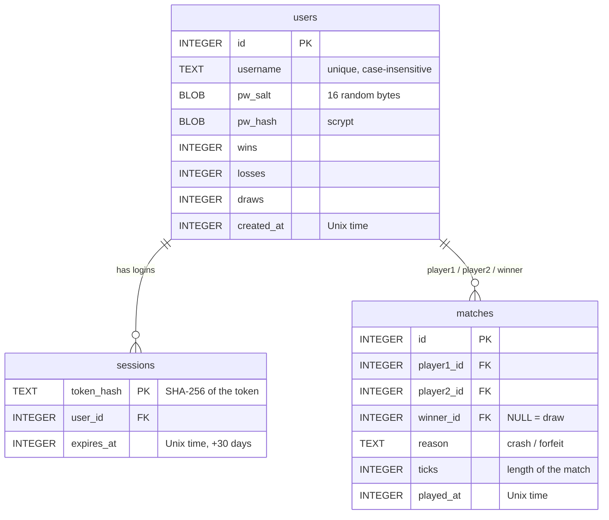

# NEON GRID – Architecture

How the program is built: components, what happens during a match, the network
messages and the database. Setup instructions are in [SETUP.md](SETUP.md), and
flowcharts of the individual functions are in [PAP.md](PAP.md).

## 1. Components

**Key design decision: the server is the referee.** The browsers send only
the keys the players press. The server moves both cycles, decides who crashed,
and sends the result to both browsers. Nobody can cheat by changing the
JavaScript, and both players always see the same game.

The whole server runs in **one process with one asyncio event loop**. Many
connections and matches run "at the same time" because each one waits
(`await`) most of the time. No threads or locks are needed. The only thread
use is password hashing (`asyncio.to_thread`), which is slow on purpose.

## 2. Files

| File | Lines (approx.) | Responsibility |
|---|---|---|
| `server/server.py` | 710 | all server logic, see the overview in the module docstring |
| `public/index.html` | 120 | markup of all screens |
| `public/game.js` | 590 | client logic |
| `public/style.css` | 330 | design |
| `scripts/lan-party.sh` | 135 | meetup hotspot |
| `deploy/neongrid.service` | 22 | systemd service for the public server |
| `deploy/neongrid-apache.conf` | 18 | Apache reverse proxy snippet |
| `tests/smoke_test.py` | 96 | end-to-end test |

## 3. Life of a match

### Game rules, as implemented in `Match.step`

- The arena has 120 × 80 cells. Player 0 (cyan) starts at (30, 40) facing right,
  and player 1 (orange) starts at (89, 40) facing left.
- In every tick both cycles move one cell **at the same time**. Each cell a
  cycle passes is marked in `occupied` and becomes a wall.
- A cycle crashes when its new cell is outside the arena or already occupied.
- If both heads reach the same cell, both crash and the match is a draw.
- Exactly one crash means the other player wins. Both crashing in the same tick
  is a draw.
- Leaving or losing the connection during the countdown or the match is a
  **forfeit**: you lose and the other player wins.
- Speed starts at 14 ticks/s and rises by 1 every 120 ticks, up to 22 ticks/s.
- Turns: a 180° turn and a turn to the current direction are ignored. Up to 3
  turns are queued, and at most one is applied per tick. So quick double-taps
  like ↑ ← both count.

## 4. HTTP API

All answers are JSON. Errors look like `{"error": "<text for the player>"}`.
The token from login/register is sent as `Authorization: Bearer <token>`.

| Method + path | Body | Success answer | Errors |
|---|---|---|---|
| `POST /api/register` | `{username, password}` | `{token, user}` | 400 invalid name/password, 409 name taken, 429 more than 5 accounts per IP per hour |
| `POST /api/login` | `{username, password}` | `{token, user}` | 400, 401 wrong name/password, 429 more than 10 failures per IP in 10 min |
| `POST /api/logout` | `{}` | `{ok: true}` | – |
| `GET /api/me` | – | `{user}` | 401 not logged in / token expired |
| `GET /api/highscores` | – | `{highscores: [user…] (top 10), total_matches}` | – |

`user` is always `{id, username, wins, losses, draws, played}`. Password data
never leaves the server.

## 5. WebSocket messages (`/ws`)

Every message is a JSON object with a `type` field.

**Browser → server**

| type | Fields | Meaning |
|---|---|---|
| `auth` | `token` | must be the first message; anything earlier is ignored |
| `join` | – | "Enter the grid": wait for, or start, a match |
| `leave` | – | cancel waiting |
| `turn` | `dir`: `up`/`down`/`left`/`right` | steer (only during a match) |

**Server → browser**

| type | Fields | Meaning |
|---|---|---|
| `auth_ok` | `user` | logged in on this connection |
| `auth_failed` | – | token invalid; the server closes the connection |
| `kicked` | – | the same account connected from another window; this one is closed |
| `waiting` | – | you are first in line |
| `idle` | – | waiting was cancelled |
| `match` | `you` (0/1), `grid` [w, h], `players` [user, user], `starts` [[x,y],[x,y]], `dirs` | an opponent was found |
| `countdown` | `n` | seconds left; `0` = go |
| `tick` | `t` (tick number), `heads` [[x,y],[x,y]], `crashed` [bool, bool] | one game step |
| `end` | `result` (`win`/`lose`/`draw`), `reason` (`crash`/`forfeit`/`error`), `me` (updated user) | match over |

The server sends a WebSocket ping every 20 s, so dead connections (for example a
laptop that left the Wi-Fi) are detected and the match is ended as a forfeit.

## 6. Database

SQLite file, default `server/neongrid.sqlite3`. The tables are created
automatically on the first start.

The `wins`/`losses`/`draws` counters are stored on the user row, so the
highscore list doesn't have to count matches. They are updated in the same
transaction that inserts the match. Matches aborted by a server error are not stored.

## 7. Security measures

| Threat | Measure |
|---|---|
| Stolen database → passwords | Passwords are stored only as salted **scrypt** hashes. |
| Stolen database → log in as someone | Only SHA-256 hashes of session tokens are stored. |
| Password guessing | Max. 10 failed logins per IP per 10 min. Unknown names take as long as wrong passwords, so attackers can't tell which names exist. |
| Account spam | Max. 5 new accounts per IP per hour. |
| Faked IP via header | `X-Forwarded-For` is only trusted when the request comes from the local Apache. |
| HTML injection via user names | Names are limited to `A–Z a–z 0–9 _ -`, and the page inserts them with `textContent`. |
| Cheating | The server decides all movement and collisions. |
| Huge requests | HTTP bodies are limited to 16 KB and WebSocket messages to 4 KB. |
| Eavesdropping | Use HTTPS in production (SETUP.md, D.1). |
| Privacy (GDPR) | The font is self-hosted, so there are no third-party requests. |
