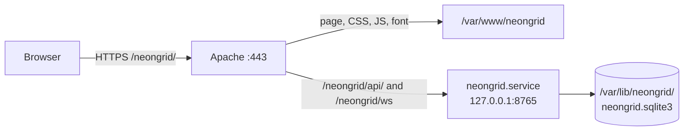

# NEON GRID – Installation on a Fresh Debian

This guide starts with a freshly installed **Debian 13 "trixie"** and ends
with a running game. Every command is meant to be typed in a terminal as
your normal user, `sudo` is added where administrator rights are needed.

| Part | You get | Needed for |
|---|---|---|
| [1. Base setup](#part-1--base-setup-every-machine) | packages, the code, Python environment, tests, first local game | **every** machine |
| [2. Meetup notebook](#part-2--meetup-notebook-hotspot-and-game-access-point) | own Wi-Fi hotspot or offline game access point with jump page | LAN parties, meetups, shows |
| [3. Public web server](#part-3--public-web-server-apache--https) | game at `https://your-domain/neongrid/`, starts at boot, daily backups | internet server |
| [4. Maintenance](#part-4--maintenance) | updates, backups, reset, uninstall | servers |

Do part 1 first, then part 2 **or** part 3, depending on what the machine is
for. Day-to-day use of every mode is described in [SETUP.md](SETUP.md).

> **Tested:** part 1 and part 3 (without systemd and certbot) were run
> step by step in a clean `debian:13` container (Debian 13.7, Python 3.13.5):
> both tests pass, Apache delivers the page, the API and the WebSocket
> through the proxy, and the database is created in `/var/lib/neongrid`.
> Part 2 needs real Wi-Fi hardware and follows the scripts, which were tested
> on the notebook.

---

## Before you install Debian

In the Debian installer, at **"Software selection"**:

| Machine | Select |
|---|---|
| **Meetup notebook** (part 2) | a desktop environment (GNOME, KDE Plasma or Xfce) + *standard system utilities*. The desktop brings **NetworkManager**, which the hotspot scripts need. |
| **Web server** (part 3) | *SSH server* + *standard system utilities*, no desktop. |
| Just playing at home (part 1) | anything |

Also in the installer:

- **Root password:** if you leave it **empty**, your user automatically gets
  `sudo` rights (recommended). If you set one, see step 1.1.
- **Wi-Fi firmware:** Debian 12 and newer include the non-free firmware most
  Wi-Fi cards need. If the installer asked for missing firmware, step 2.1
  shows how to install it later.

---

## Part 1 – Base setup (every machine)

### 1.1 Get sudo rights

Check whether your user may use `sudo`:

```bash
sudo true && echo "sudo works"
```

If you get *"… is not in the sudoers file"* (you set a root password in the
installer), add yourself to the `sudo` group once:

```bash
su -                         # enter the ROOT password
apt install sudo
usermod -aG sudo joerg       # your user name instead of joerg
exit
```

Then **log out and in again** (or reboot) so the new group takes effect.

### 1.2 Update and install the basic packages

```bash
sudo apt update && sudo apt full-upgrade -y
sudo apt install -y git python3 python3-venv curl sqlite3
```

| Package | Why |
|---|---|
| `git` | fetch the code and later updates |
| `python3`, `python3-venv` | runs the game server in its own Python environment |
| `curl` | quick checks from the command line |
| `sqlite3` | look into and back up the database |

Debian 13 ships Python 3.13; NEON GRID needs 3.9 or newer.

### 1.3 Get the code

The repository is **private** on GitHub, so you have to log in once. The
easiest way is the GitHub CLI:

```bash
sudo apt install -y gh
gh auth login            # GitHub.com → HTTPS → "Login with a web browser"
gh repo clone joergr72idb/neon-grid ~/neon-grid
```

`gh auth login` shows a one-time code. On a machine without a browser (web
server over SSH), open the address it prints on any other computer or your
phone and enter the code there.

**Without GitHub access** (for example at a show without internet), copy
the folder from another computer instead, e.g. with a USB stick or:

```bash
scp -r joerg@other-pc:neon-grid ~/neon-grid
```

All later commands assume the code is in **`~/neon-grid`**.

### 1.4 Python environment

```bash
cd ~/neon-grid
python3 -m venv .venv
.venv/bin/pip install -r server/requirements.txt
```

This creates a private Python environment in `~/neon-grid/.venv` and
installs `aiohttp` (the web server library) into it. Nothing is installed
system-wide. The folder is not part of git.

### 1.5 Run the tests

```bash
.venv/bin/python tests/smoke_test.py
.venv/bin/python tests/portal_test.py
```

Both must end with a line starting with **`OK –`**. The smoke test plays two
complete matches against a temporary database.

### 1.6 First game

```bash
cd ~/neon-grid/server
../.venv/bin/python server.py --static ../public
```

Open **http://127.0.0.1:8765/** in two browser windows (one normal, one
private), create two accounts and press *Enter the grid* in both. **Ctrl+C**
stops the server.

To let other computers in your network play, add `--host 0.0.0.0`. They then
open `http://<ip-of-this-machine>:8765/` (`hostname -I` shows the address).
Debian has no firewall by default. If you installed `ufw`, allow the port with
`sudo ufw allow 8765/tcp`.

Part 1 is done. Continue with part 2 or part 3.

---

## Part 2 – Meetup notebook (hotspot and game access point)

Two scripts turn the notebook into a Wi-Fi network for the players:

| Script | Internet for the players | Game address |
|---|---|---|
| `scripts/lan-party.sh` | yes, from a phone via USB tethering | `http://10.42.0.1:8765/` |
| `scripts/neongrid-ap.sh` | no; joining devices open the game by themselves (jump page) | `http://10.42.0.1/` |

### 2.1 Packages

```bash
sudo apt install -y network-manager dnsmasq-base nftables iw qrencode
```

| Package | Why |
|---|---|
| `network-manager` | creates the hotspot / access point (`nmcli`); already there with a desktop |
| `dnsmasq-base` | NetworkManager uses it to hand out IP addresses and answer DNS on the hotspot |
| `nftables` | port 80 → game server, for the access point |
| `iw` | check whether the Wi-Fi card can be an access point |
| `qrencode` | optional: the access point prints a QR code to join the Wi-Fi |

> Install **`dnsmasq-base`, not `dnsmasq`**. The full `dnsmasq` package starts
> its own service on DNS port 53 and blocks the hotspot. The scripts pause that
> service if it runs, but you don't need it at all.

**Wi-Fi card without firmware?** If `nmcli device` shows no `wifi` device,
the firmware is probably missing. Check `sudo dmesg | grep -i firmware`, then
install the matching package, for example:

```bash
sudo apt install -y firmware-iwlwifi          # Intel
# firmware-atheros, firmware-realtek, firmware-mediatek, firmware-brcm80211 …
sudo reboot
```

(The `non-free-firmware` section is enabled by default on Debian 12 and newer.
If `apt` can't find the package, add `non-free-firmware` to the lines in
`/etc/apt/sources.list` or `/etc/apt/sources.list.d/debian.sources`, then
`sudo apt update`.)

### 2.2 Let NetworkManager manage the Wi-Fi

With a desktop installation this is already the case. Check:

```bash
nmcli device
```

The Wi-Fi device (e.g. `wlp2s0`) must **not** say `unmanaged`. If it does,
the Wi-Fi was configured by the installer in `/etc/network/interfaces`, and
NetworkManager leaves it alone. Fix:

```bash
sudo cp /etc/network/interfaces /etc/network/interfaces.bak
sudo nano /etc/network/interfaces
#   delete (or put "#" in front of) every block that mentions the Wi-Fi device,
#   e.g. "allow-hotplug wlp2s0", "iface wlp2s0 inet dhcp" and the wpa-* lines.
#   Keep the "lo" (loopback) lines.
sudo systemctl restart NetworkManager
nmcli device wifi connect "YourHomeWifi" --ask   # reconnect your normal Wi-Fi
```

### 2.3 Can the Wi-Fi card be an access point?

```bash
iw list | grep -A 10 "Supported interface modes"
```

The list must contain **`* AP`**. Almost all Intel, Atheros and MediaTek cards
can do this. If not, a cheap USB Wi-Fi stick with AP support helps.

### 2.4 Rights for `nmcli`

The scripts change Wi-Fi settings with `nmcli`. In a **desktop session** your
user may do that without a password. Over **SSH** NetworkManager answers
*"Not authorized"*; then run `lan-party.sh` with `sudo -E`, or start the
scripts from the desktop. `neongrid-ap.sh` always asks for the sudo password
by itself (it also writes a DNS setting and a firewall rule) and still runs
the game server as your normal user.

### 2.5 Dry run at home

Do this once at home, so there are no surprises at the event:

```bash
cd ~/neon-grid
scripts/neongrid-ap.sh          # Wi-Fi "Neongrid", password "1234neongrid"
```

1. Join the Wi-Fi **Neongrid** with a phone. After a few seconds it should
   show *"Sign in to network"* and open the game.
2. Play a round against a second device (or a browser window on the notebook
   at `http://10.42.0.1/`).
3. Press **Ctrl+C**. The script removes the access point and reconnects your
   normal Wi-Fi.

For the hotspot with internet, connect a phone with USB tethering and run
`scripts/lan-party.sh`. Own Wi-Fi name and password for either script:

```bash
SSID=LUG-GRID PASSWORD=secret123 scripts/neongrid-ap.sh
```

Everything about the event itself (what players see, phone quirks, full
troubleshooting tables) is in [SETUP.md, sections C and C2](SETUP.md#c-meetup-mode-own-wi-fi-hotspot).

### 2.6 If something went wrong

If a script was killed hard (power loss, closed terminal), clean up by hand:

```bash
sudo nft delete table ip neongrid_portal
sudo rm -f /etc/NetworkManager/dnsmasq-shared.d/neongrid-portal.conf
nmcli connection delete neongrid-ap
nmcli connection delete neongrid-hotspot
```

Starting the script again also removes leftovers.

---

## Part 3 – Public web server (Apache + HTTPS)

Apache delivers the web page and passes the API and the live game connection
(WebSocket) on to the game server. The game server runs as a systemd service
under its own user, with no login and no rights outside its data folder.



**Before you start:**

- Part 1 is done (code in `~/neon-grid`, tests pass).
- A **domain name** (e.g. `game.example.org`) points to the server's public
  IP address (DNS "A" record), and ports **80** and **443** reach the server
  (router port forwarding if it's at home). Let's Encrypt needs both for the
  certificate.

In the commands below, replace **`game.example.org`** with your domain.

### 3.1 Packages

```bash
sudo apt install -y apache2 certbot python3-certbot-apache ufw
```

### 3.2 Firewall

```bash
sudo ufw allow 22/tcp      # SSH – FIRST, or you lock yourself out
sudo ufw allow 80/tcp      # HTTP (needed for the certificate and the redirect to HTTPS)
sudo ufw allow 443/tcp     # HTTPS
sudo ufw enable
sudo ufw status
```

The game server's port 8765 stays closed: it only listens on `127.0.0.1`
and is reached through Apache.

### 3.3 Service user, folders and code

```bash
cd ~/neon-grid

# system user "neongrid" without password and without login shell
sudo useradd --system --home /var/lib/neongrid --shell /usr/sbin/nologin neongrid

sudo mkdir -p /opt/neongrid/server /var/lib/neongrid /var/www/neongrid
sudo cp server/server.py server/requirements.txt /opt/neongrid/server/
sudo cp -r public/. /var/www/neongrid/
sudo chown neongrid:neongrid /var/lib/neongrid
```

| Folder | Content | Owner |
|---|---|---|
| `/opt/neongrid/` | game server + its Python environment | root (read-only for the service) |
| `/var/www/neongrid/` | the web page (copy of `public/`) | root |
| `/var/lib/neongrid/` | the database with accounts and scores | `neongrid` |

Copy only `server.py` and `requirements.txt`, not the whole `server/`
folder: a test database lying around there would otherwise end up on the
server.

### 3.4 Python environment for the service

```bash
sudo python3 -m venv /opt/neongrid/.venv
sudo /opt/neongrid/.venv/bin/pip install -r /opt/neongrid/server/requirements.txt
```

### 3.5 Game server as a systemd service

```bash
sudo cp ~/neon-grid/deploy/neongrid.service /etc/systemd/system/
sudo systemctl daemon-reload
sudo systemctl enable --now neongrid
systemctl status neongrid --no-pager
```

The status must say **`active (running)`**. Quick check that it answers:

```bash
curl -s http://127.0.0.1:8765/api/highscores
# {"highscores": [], "total_matches": 0}
```

The service starts at every boot, restarts by itself after a crash, and is
sandboxed (`ProtectSystem=strict`, `ProtectHome`, `PrivateTmp`,
`NoNewPrivileges`): it can only write to `/var/lib/neongrid`.

### 3.6 Apache

Enable the proxy modules and install the NEON GRID snippet as a global
configuration. It then applies to every site on this server, including the
HTTPS site certbot creates in the next step:

```bash
sudo a2enmod proxy proxy_http proxy_wstunnel
sudo cp ~/neon-grid/deploy/neongrid-apache.conf /etc/apache2/conf-available/neongrid.conf
sudo a2enconf neongrid
```

Give the default site your domain name, so certbot finds it:

```bash
sudo sed -i 's/#ServerName www.example.com/ServerName game.example.org/' \
    /etc/apache2/sites-available/000-default.conf
sudo apachectl configtest && sudo systemctl reload apache2
```

`configtest` must print **`Syntax OK`**. Test over plain HTTP first:

```bash
curl -s -o /dev/null -w "%{http_code}\n" http://game.example.org/neongrid/   # 200
curl -s http://game.example.org/neongrid/api/highscores                      # JSON
```

> **Already running a website on this server** with its own `<VirtualHost>`?
> The global snippet works there too. If you prefer, paste the lines of
> `deploy/neongrid-apache.conf` into that `<VirtualHost *:443>` block instead
> of `a2enconf`.

### 3.7 HTTPS certificate (Let's Encrypt)

```bash
sudo certbot --apache -d game.example.org
```

Answer the questions (e-mail address for expiry warnings, accept the terms).
Certbot gets the certificate, creates the HTTPS site and redirects HTTP to
HTTPS. Renewal runs automatically (`systemctl list-timers | grep certbot`).

**Use HTTPS.** Passwords are sent when players log in. The game switches to an
encrypted WebSocket (`wss://`) by itself when the page is opened via `https://`.

### 3.8 Check

Open **https://game.example.org/neongrid/** in two browsers, create two
accounts and play one match. Then:

```bash
journalctl -u neongrid -n 20 --no-pager      # log of the game server
sudo sqlite3 /var/lib/neongrid/neongrid.sqlite3 \
    "select username, wins, losses, draws from users;"
```

### 3.9 Daily backup of the database

The database holds all accounts and scores. A systemd timer makes a
consistent copy every night (safe while the game is running) and keeps 14
days:

```bash
sudo mkdir -p /var/backups/neongrid

sudo tee /etc/systemd/system/neongrid-backup.service >/dev/null <<'EOF'
[Unit]
Description=Back up the NEON GRID database

[Service]
Type=oneshot
ExecStart=/bin/sh -c 'sqlite3 /var/lib/neongrid/neongrid.sqlite3 ".backup /var/backups/neongrid/neongrid-$(date +%%F).sqlite3"'
ExecStartPost=/usr/bin/find /var/backups/neongrid -name "neongrid-*.sqlite3" -mtime +14 -delete
EOF

sudo tee /etc/systemd/system/neongrid-backup.timer >/dev/null <<'EOF'
[Unit]
Description=Daily NEON GRID database backup

[Timer]
OnCalendar=*-*-* 03:30
Persistent=true

[Install]
WantedBy=timers.target
EOF

sudo systemctl daemon-reload
sudo systemctl enable --now neongrid-backup.timer
sudo systemctl start neongrid-backup.service     # make the first backup right now
ls -l /var/backups/neongrid
```

Copy `/var/backups/neongrid` to another machine from time to time: a backup
on the same disk does not help if the disk dies.

---

## Part 4 – Maintenance

### Update to a new version

On the **server** (part 3):

```bash
cd ~/neon-grid && git pull
sudo cp server/server.py server/requirements.txt /opt/neongrid/server/
sudo /opt/neongrid/.venv/bin/pip install -r /opt/neongrid/server/requirements.txt
sudo cp -r public/. /var/www/neongrid/
sudo systemctl restart neongrid
```

Matches running during the restart are aborted and not counted. Accounts and
scores are kept. Players may need to reload the page (Ctrl+F5) to get the new
JavaScript.

On a **notebook** (parts 1 and 2), `git pull` is enough, followed by
`.venv/bin/pip install -r server/requirements.txt` if `requirements.txt`
changed.

Debian updates: `sudo apt update && sudo apt full-upgrade`. After a Python
upgrade between Debian releases, recreate the environments:
`rm -rf .venv` (or `sudo rm -rf /opt/neongrid/.venv`) and repeat step 1.4
(or 3.4), then restart the service.

### Restore a backup

```bash
sudo systemctl stop neongrid
sudo cp /var/backups/neongrid/neongrid-2026-11-06.sqlite3 /var/lib/neongrid/neongrid.sqlite3
sudo rm -f /var/lib/neongrid/neongrid.sqlite3-wal /var/lib/neongrid/neongrid.sqlite3-shm
sudo chown neongrid:neongrid /var/lib/neongrid/neongrid.sqlite3
sudo systemctl start neongrid
```

### Reset all accounts and scores

```bash
# server
sudo systemctl stop neongrid
sudo rm -f /var/lib/neongrid/neongrid.sqlite3*
sudo systemctl start neongrid

# notebook (server not running)
rm -f ~/neon-grid/server/neongrid.sqlite3*
```

### Useful commands

| Task | Command |
|---|---|
| live log | `journalctl -u neongrid -f` |
| status / restart | `systemctl status neongrid` / `sudo systemctl restart neongrid` |
| Apache error log | `sudo tail -f /var/log/apache2/error.log` |
| who has the most wins | `sudo sqlite3 /var/lib/neongrid/neongrid.sqlite3 "select username, wins from users order by wins desc limit 10;"` |
| certificate status | `sudo certbot certificates` |

### Uninstall (server)

```bash
sudo systemctl disable --now neongrid neongrid-backup.timer
sudo rm -f /etc/systemd/system/neongrid.service \
           /etc/systemd/system/neongrid-backup.service /etc/systemd/system/neongrid-backup.timer
sudo systemctl daemon-reload
sudo a2disconf neongrid && sudo rm -f /etc/apache2/conf-available/neongrid.conf
sudo systemctl reload apache2
sudo rm -rf /opt/neongrid /var/www/neongrid
sudo userdel neongrid
# the database and backups stay until you delete them yourself:
#   sudo rm -rf /var/lib/neongrid /var/backups/neongrid
```

---

## Troubleshooting

| Problem | Solution |
|---|---|
| `… is not in the sudoers file` | Step 1.1, then log out and in again. |
| `gh: command not found` / `Unable to locate package gh` | `sudo apt update` first. Or copy the folder instead (step 1.3). |
| `ModuleNotFoundError: aiohttp` | You used the system Python. Use `.venv/bin/python`, or repeat step 1.4. |
| `address already in use` | A game server is already running: `pkill -f server.py` (notebook) or check `systemctl status neongrid` (server). |
| `systemctl status neongrid` shows `failed` | `journalctl -u neongrid -n 50 --no-pager` shows why. Usually `/opt/neongrid/.venv` is missing (step 3.4) or `/var/lib/neongrid` doesn't belong to `neongrid` (step 3.3). |
| page loads, but login fails / "connection lost" | The proxy modules are missing: `sudo a2enmod proxy proxy_http proxy_wstunnel && sudo systemctl restart apache2`. |
| `/neongrid/` gives 404 | The snippet is not active: `sudo a2enconf neongrid && sudo systemctl reload apache2`. |
| certbot: *"Could not find a VirtualHost"* / connection error | `ServerName` missing (step 3.6), DNS doesn't point to the server yet, or port 80 is blocked (firewall, router). |
| hotspot / access point problems | Part 2 and the troubleshooting tables in [SETUP.md](SETUP.md#c7-troubleshooting-meetup-mode). |
