# NEON GRID – Programmablaufplan (PAP)

These program flowcharts follow the symbols of **DIN 66001**. Each chart
describes one function or process of the program, and the heading names the
function in the source code. For the big picture, see [ARCHITECTURE.md](ARCHITECTURE.md).

**Legend (DIN 66001)**

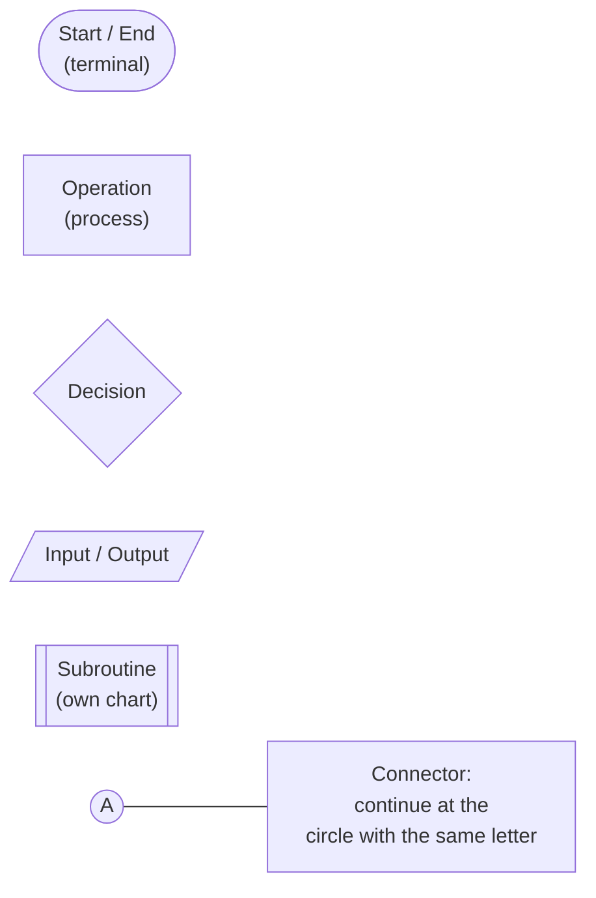

The charts are written in Mermaid. GitHub, GitLab, VS Code (Markdown preview),
JetBrains IDEs and Obsidian display them as graphics. You can also paste a code
block into https://mermaid.live to view it or export it as PNG/SVG.

**Overview**

| No. | Flowchart | Source |
|---|---|---|
| 1 | Server start | `server.py` → `main`, `make_app` |
| 2 | Registration | `server.py` → `register` |
| 3 | Login | `server.py` → `login` |
| 4 | WebSocket connection of one browser | `server.py` → `websocket` |
| 5 | Matchmaking ("Enter the grid") | `server.py` → `Lobby.join` |
| 6 | Match flow (countdown and game loop) | `server.py` → `Match.run` |
| 7 | One game step (movement and collision) | `server.py` → `Match.step` |
| 8 | Steering command | `server.py` → `Match.turn` |
| 9 | End of a match | `server.py` → `Match.finish`, `Lobby.disconnect` |
| 10 | Browser: page start and menu | `game.js` → `init`, `submitAuth`, `play` |
| 11 | Browser: during a match | `game.js` → `handleMessage`, `onTick`, `onEnd` |
| 12 | Game access point with jump page | `scripts/neongrid-ap.sh`, `server.py` → `captive_portal_middleware` |

---

## 1. Server start (`main`, `make_app`)

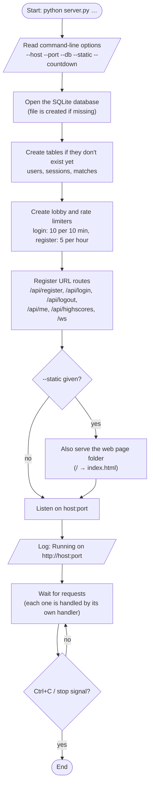

## 2. Registration (`register`)

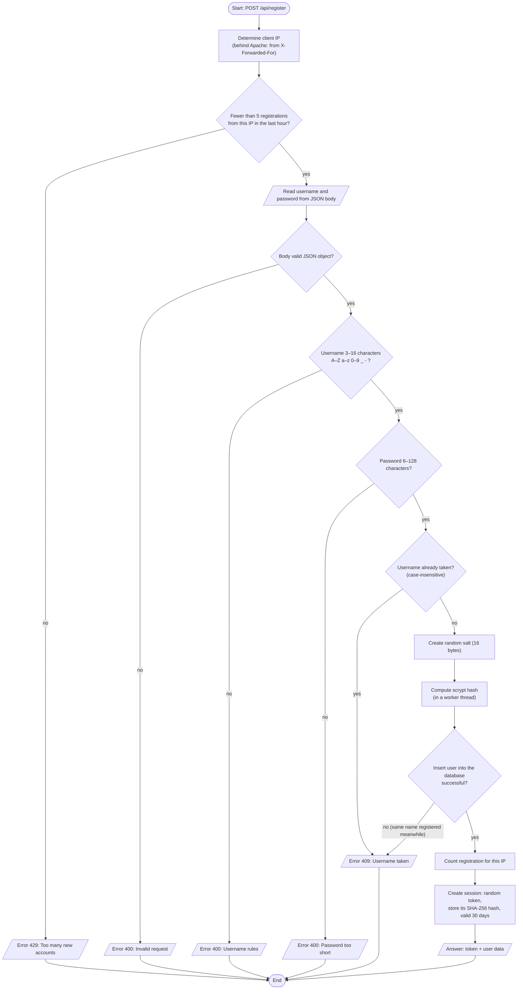

## 3. Login (`login`)

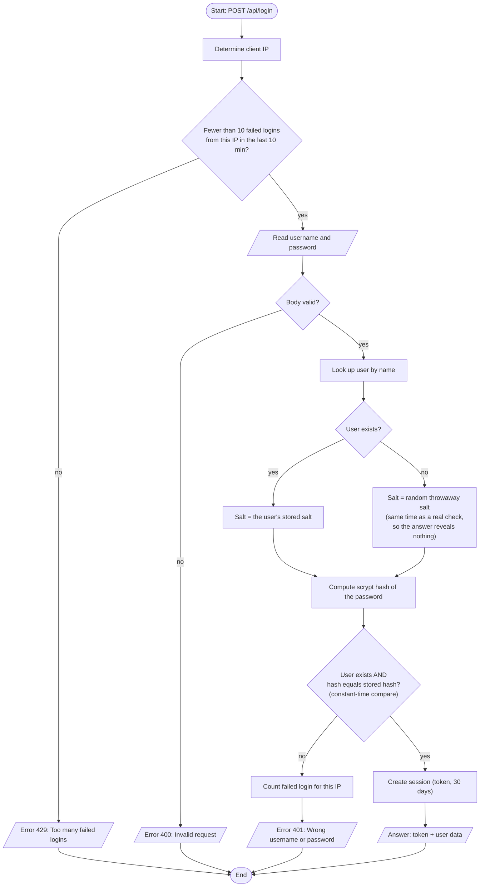

## 4. WebSocket connection of one browser (`websocket`)

One of these runs for every open browser tab.

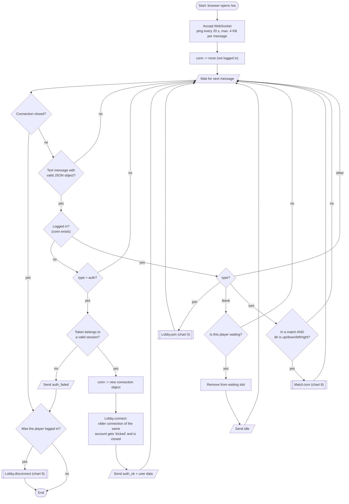

## 5. Matchmaking (`Lobby.join`)

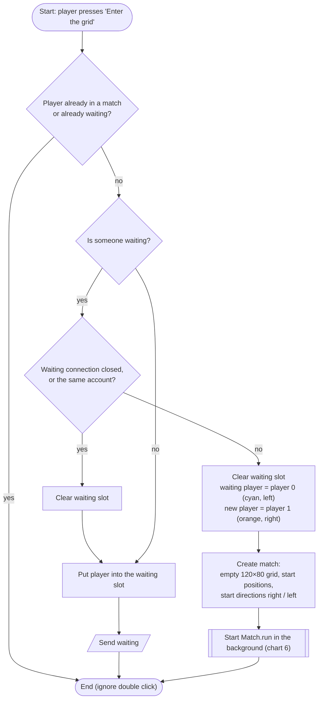

## 6. Match flow (`Match.run`)

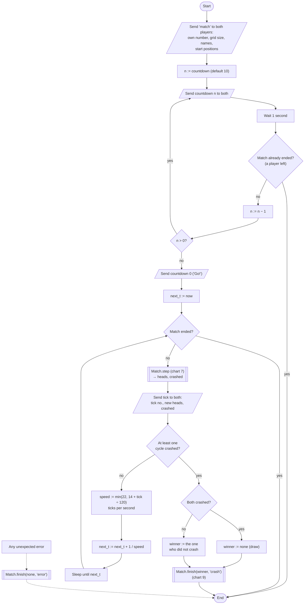

## 7. One game step (`Match.step`)

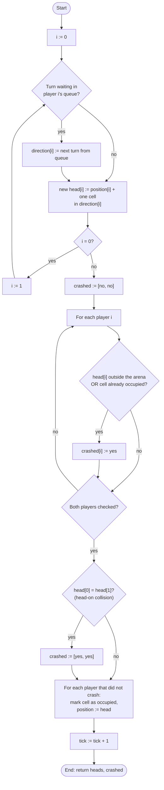

Both cycles are moved and checked **together**: first both new heads, then both
checks, and only then are the cells marked. Neither player gets an advantage
from being processed first.

## 8. Steering command (`Match.turn`)

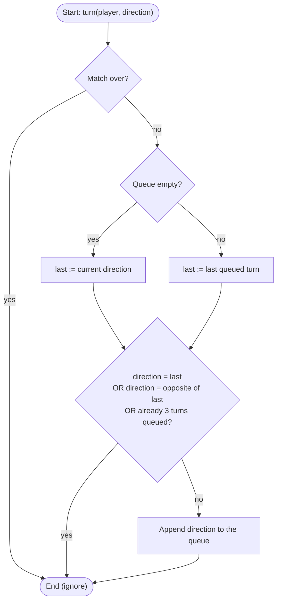

## 9. End of a match (`Match.finish`, `Lobby.disconnect`)

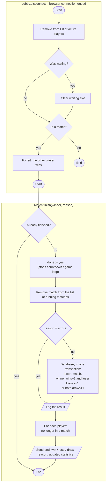

## 10. Browser: page start and menu (`init`, `submitAuth`, `play`)

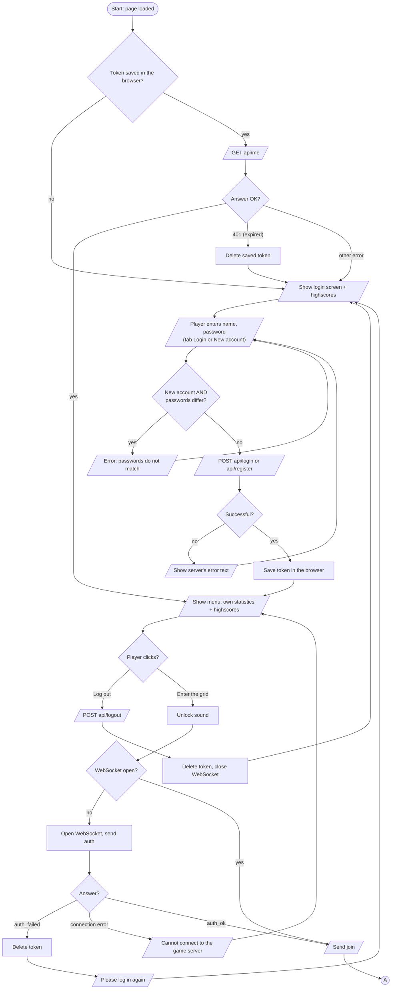

## 11. Browser: during a match (`handleMessage`, `onTick`, `onEnd`)

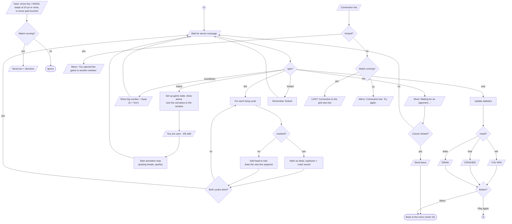

"Play again" goes back to the menu and immediately sends `join` again (connector A).

## 12. Game access point with jump page (`scripts/neongrid-ap.sh`)

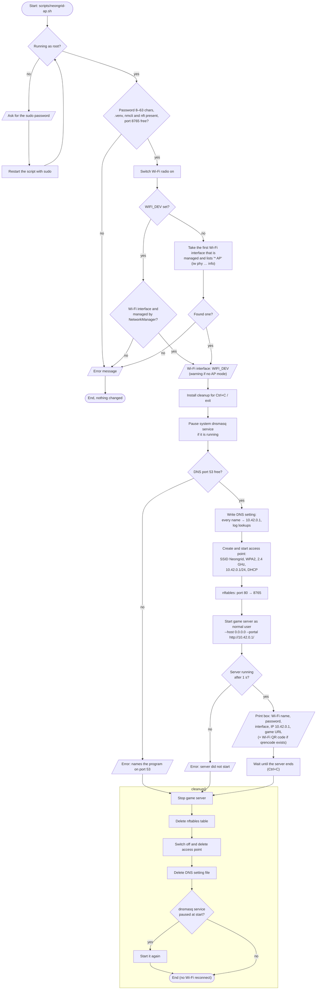

**What happens when a phone joins** (`captive_portal_middleware` in server.py):

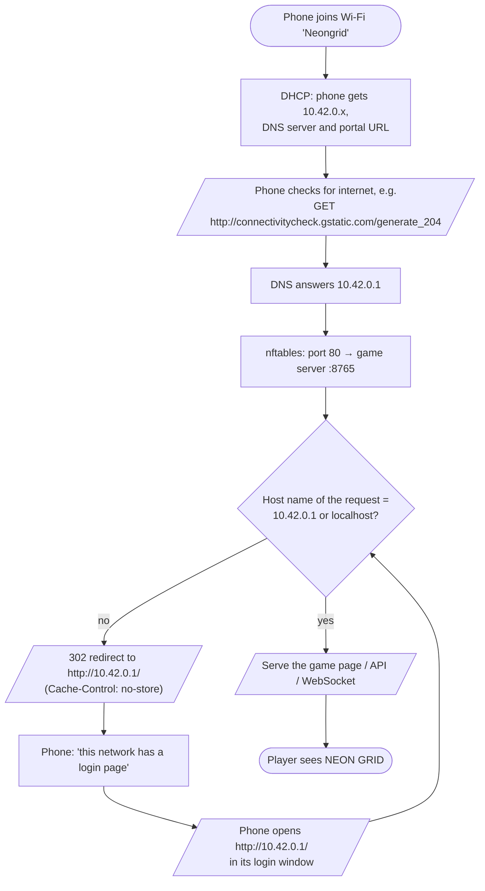
