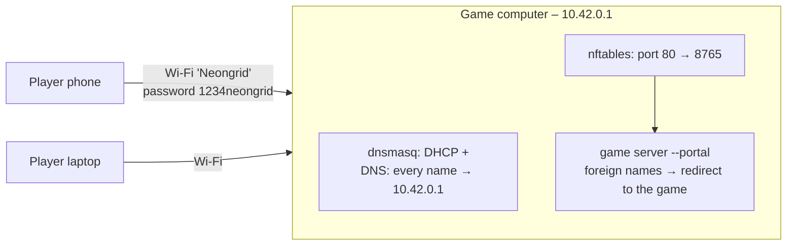
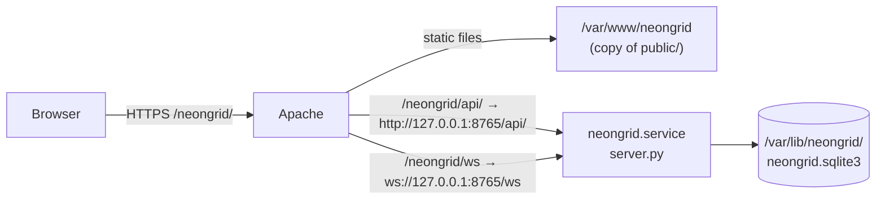

# NEON GRID – Setup Guide

This guide explains how to install and run NEON GRID in every supported way.
Pick the scenario that fits you:

| Scenario | Who can play | Section |
|---|---|---|
| **A. Local** – everything on one computer | you, in two browser windows | [A](#a-local-on-one-computer) |
| **B. Home network** – one computer is the server | everyone on your Wi-Fi/LAN | [B](#b-home-network-lan) |
| **C. Game access point** – own Wi-Fi *Neongrid*, no internet, game opens by itself | everyone near the computer | [C](#c-game-access-point-own-wi-fi-jump-page) |
| **D. Internet** – Apache web server with HTTPS | everyone on the internet | [D](#d-public-server-with-apache) |

Setting up a freshly installed Debian machine? Start with
[INSTALL-DEBIAN.md](INSTALL-DEBIAN.md). Other documents:
[ARCHITECTURE.md](ARCHITECTURE.md) explains how the program is
built, and [PAP.md](PAP.md) has the program flowcharts.

---

## 0. Requirements and one-time setup

**What you need**

- Linux (tested on Debian 13; Ubuntu works the same way)
- Python 3.9 or newer with the `venv` module (`sudo apt install python3 python3-venv`)
- A modern browser (Firefox, Chrome, Edge, Safari)
- **Controls:** on a computer, the arrow keys or W A S D. On phones and
  tablets, swipe in the direction you want to turn, or tap the on-screen arrow
  pad. The pad sits below the arena when the phone is held upright and to the
  right of it when held sideways. Turning the phone during a match is fine.

**Install the Python environment** (only once, or again after deleting `.venv/`):

```bash
cd ~/neon-grid
python3 -m venv .venv                              # private Python environment in .venv/
.venv/bin/pip install -r server/requirements.txt   # installs aiohttp (web server library)
```

**Check that it works:**

```bash
.venv/bin/python tests/smoke_test.py
.venv/bin/python tests/portal_test.py
```

Each test's last line should start with `OK –`. The test plays two complete matches
against a temporary database. It doesn't touch your real scores.

### What is where

| Path | Content |
|---|---|
| `server/server.py` | the game server (accounts, matchmaking, game logic) |
| `server/requirements.txt` | Python libraries the server needs |
| `server/neongrid.sqlite3` | **database** with accounts and scores (created on first start, not in git) |
| `public/` | the web page: `index.html`, `style.css`, `game.js`, font |
| `scripts/neongrid-ap.sh` | game access point without internet, with jump page |
| `deploy/` | config files for the Apache server (scenario D) |
| `tests/smoke_test.py`, `tests/portal_test.py` | automatic tests |

---

## A. Local on one computer

```bash
cd ~/neon-grid/server
../.venv/bin/python server.py --static ../public
```

When you see `Running on http://127.0.0.1:8765`, open **http://127.0.0.1:8765/**
in two browser windows. Use a different account in each one, for example a normal
window and a private window: one account can only be connected once, and a second
window "kicks" the first. Create an account in both windows and press **Enter the grid** in both.

Stop the server with **Ctrl+C**.

> `--static ../public` makes the game server deliver the web page itself, so
> you don't need Apache. Tip for testing: `--countdown 3` shortens the 10-second
> countdown.

### Running it in the background

```bash
cd ~/neon-grid/server
nohup ../.venv/bin/python server.py --static ../public > neongrid.log 2>&1 &
tail -f neongrid.log            # watch the log (Ctrl+C only ends tail)
pkill -f "server.py --static"   # stop the server
```

---

## B. Home network (LAN)

Same as A, but the server listens on all network interfaces:

```bash
cd ~/neon-grid/server
../.venv/bin/python server.py --static ../public --host 0.0.0.0
```

1. Find the computer's IP address with `hostname -I`. The first entry, for example
   `192.168.178.23`, is usually the right one.
2. The other players open `http://192.168.178.23:8765/`.
3. If a firewall is active (`sudo ufw status` says *active*), allow the port:
   `sudo ufw allow 8765/tcp`.

> There is no HTTPS in this mode, so passwords travel unencrypted through your
> network. That's fine at home. Don't reuse important passwords.

---

## C. Game access point (own Wi-Fi, jump page)

The computer opens its own Wi-Fi **Neongrid** and serves only the game. No
internet and no phone are needed. When players join the Wi-Fi, their phone or
laptop **opens the game by itself**, the same way hotel Wi-Fis open their login
page. That page is the "jump page". Any `http://` address typed into a browser
also leads to the game.



For LAN parties, meetups and shows. Players can use phones, tablets and
laptops; they only have to join the Wi-Fi.

### C.1 What you need

| Item | Notes |
|---|---|
| Linux with **NetworkManager** and **nftables** | standard on Debian/Ubuntu desktops; check with `nmcli --version` and `sudo nft --version` |
| `dnsmasq-base` package | NetworkManager uses it to hand out IP addresses and answer DNS: `sudo apt install dnsmasq-base` |
| Wi-Fi card that supports **access point (AP) mode** | almost all Intel, Atheros and MediaTek cards do; the script checks it by itself (needs `iw`: `sudo apt install iw`) |
| Power supply | being an access point uses a lot of battery |
| Python environment | see [section 0](#0-requirements-and-one-time-setup) |
| optional: `qrencode` | prints a QR code players can scan to join the Wi-Fi |

On a freshly installed Debian, [INSTALL-DEBIAN.md, part 2](INSTALL-DEBIAN.md#part-2--game-access-point-notebook)
covers all of this step by step.

**Try it at home first:** start the script, join with a phone, play one round
against a second device, press Ctrl+C. Then there are no surprises at the event.

### C.2 Start

```bash
cd ~/neon-grid
scripts/neongrid-ap.sh
```

The script asks for your **sudo password**, because creating the DNS setting and
the port-80 rule needs administrator rights. The game server itself still runs
as your normal user.

The **Wi-Fi interface is found automatically**: the script takes the first one
that NetworkManager manages and whose card supports access point mode, and
prints it (`Wi-Fi interface: wlp2s0`). That way a USB Wi-Fi stick with AP
support is picked even if the built-in card can't do it. To choose one by
hand (`nmcli device` lists them):

```bash
WIFI_DEV=wlx00c0ca123456 scripts/neongrid-ap.sh
```

The script then prints:

```
  ┌────────────────────────────────────────────┐
     NEON GRID access point is live

     Wi-Fi:       Neongrid
     Password:    1234neongrid
     Interface:   wlp2s0
     IP address:  10.42.0.1
     Game:        http://10.42.0.1/
     …
  └────────────────────────────────────────────┘
```

If `qrencode` is installed (`sudo apt install qrencode`), a QR code follows.
Players can scan it with the phone camera to join the Wi-Fi without typing the
password.

Other name or password: `SSID=Grid2 PASSWORD=secret123 scripts/neongrid-ap.sh`.
The password needs 8–63 characters.

**Stop:** press **Ctrl+C**. The script removes the access point, the DNS setting
and the port rule again. It does not reconnect any other Wi-Fi afterwards; if
you need one, connect in the network menu (NetworkManager may also do it by
itself for a known network).

> **Before you start:**
> - Stop any game server that is already running (`pkill -f server.py`). The
>   script refuses to start while port 8765 is in use.
> - The Wi-Fi card can be either an access point or connected to another
>   Wi-Fi, not both. **This computer loses its normal Wi-Fi/internet while the
>   access point runs.** A cable (Ethernet) connection keeps working.
> - If another Wi-Fi with the same name **Neongrid** is nearby (for example a
>   phone hotspot with that name), switch it off. Otherwise devices may join
>   the wrong one.

### C.3 What players see

1. Join the Wi-Fi **Neongrid** with password **1234neongrid**.
2. After a few seconds the phone shows **"Sign in to network"** (Android) or opens
   a login window by itself (iPhone, iPad, Mac). Windows opens the browser.
   The game appears in it.
3. If nothing opens: start the browser and enter **10.42.0.1**, or any `http://`
   address. They all lead to the game.

Notes for players:

- **iPhone/iPad:** the login window works for playing. If it is closed with
  *Cancel*, choose **"Use Without Internet"** to stay on the Wi-Fi, then open
  Safari at `10.42.0.1`.
- **Android:** the phone may say "No internet". Choose **"Stay connected"**. If the
  page doesn't load in Chrome, switch off **mobile data**: Android otherwise
  sends browser traffic over mobile data, because the Wi-Fi "has no internet".
- **https:// addresses** (for example a bookmarked https://google.com) can't be
  redirected and just fail. Type `10.42.0.1` instead.
- On the game computer itself, open `http://10.42.0.1/` or `http://127.0.0.1:8765/`.

### C.4 How the jump page works

| Step | What happens |
|---|---|
| 1 | NetworkManager switches the Wi-Fi card to access-point mode (2.4 GHz, WPA2) with the fixed address 10.42.0.1. Its built-in dnsmasq hands out addresses 10.42.0.x to the players (DHCP). |
| 2 | The extra file `/etc/NetworkManager/dnsmasq-shared.d/neongrid-portal.conf` makes dnsmasq answer **every** DNS name with 10.42.0.1 and log each lookup. |
| 3 | An nftables table `neongrid_portal` forwards port 80 (normal web traffic) to the game server on port 8765. |
| 4 | Right after joining, every device tests for internet by loading a known page, e.g. `http://connectivitycheck.gstatic.com/generate_204` (Android) or `http://captive.apple.com/hotspot-detect.html` (Apple). Because of steps 2 and 3, the test reaches the game server. |
| 5 | The game server runs with `--portal http://10.42.0.1/`. It answers every request for a foreign host name with a redirect to the game. The device takes that as a login page and shows it: the game. |

All of this exists only while the script runs. `tests/portal_test.py` checks
step 5 for Android, Apple, Windows, Firefox and Linux connectivity checks.

### C.5 Troubleshooting

| Problem | Cause / solution |
|---|---|
| `Port 8765 is already in use` | Another game server is running: `pkill -f server.py`, then start again. |
| `No Wi-Fi interface found.` | Wi-Fi is hard-blocked (airplane mode switch / key), its firmware is missing, or there's no Wi-Fi card. `rfkill list` shows blocks, `sudo dmesg \| grep -i firmware` missing firmware. |
| `… NetworkManager doesn't manage them` | The Wi-Fi is configured in `/etc/network/interfaces`. See [INSTALL-DEBIAN.md, step 2.2](INSTALL-DEBIAN.md#22-let-networkmanager-manage-the-wi-fi). |
| `None of the Wi-Fi cards supports access point (AP) mode` | Use a USB Wi-Fi stick with AP support. To try a card anyway: `WIFI_DEV=<interface> scripts/neongrid-ap.sh`. |
| The wrong Wi-Fi card is used | Choose it by hand: `WIFI_DEV=<interface> scripts/neongrid-ap.sh` (names from `nmcli device`). |
| Error at "Starting access point" | `dnsmasq-base` is missing (`sudo apt install dnsmasq-base`), or the card can't be an access point after all (check with `/sbin/iw list`, it needs `* AP`). |
| `Address already in use` / port 53 | The full `dnsmasq` package runs its own service on port 53, which blocks the access point's DNS. The script now pauses `dnsmasq.service` while it runs and starts it again on exit. If another program holds port 53, the script names it (`sudo ss -lunp 'sport = :53'`). |
| Players see the Wi-Fi but can't connect | Wrong password (case-sensitive), or a very old device without WPA2 support. |
| Players get no IP address | A firewall blocks DHCP/DNS. If `ufw` is active: `sudo ufw allow in on <wifi-device>` (device name from `nmcli device`). |
| No jump page appears, but `10.42.0.1` works in the browser | Some devices only check after a while or remember the network as "no internet". Forget the Wi-Fi on the device and join again, or open `10.42.0.1` by hand. On Android, set *Settings → Private DNS* to *Automatic* or *Off*: a fixed provider (e.g. dns.google) bypasses the game's DNS. To see where it stops, watch both logs while the phone joins: `sudo journalctl -f \| grep dnsmasq` should show a query for `connectivitycheck.gstatic.com`, and the script's terminal a line `portal: 10.42.0.x asked for http://connectivitycheck.gstatic.com/generate_204`. No query = the phone doesn't use our DNS; query but no portal line = port 80 doesn't reach the server. |
| The script was killed hard (e.g. power loss) | Clean up by hand: `sudo nft delete table ip neongrid_portal; sudo rm -f /etc/NetworkManager/dnsmasq-shared.d/neongrid-portal.conf; nmcli connection delete neongrid-ap`. Starting the script again also cleans up leftovers. |

---

## D. Public server with Apache

> **New machine?** [INSTALL-DEBIAN.md, part 3](INSTALL-DEBIAN.md#part-3--public-web-server-apache--https)
> walks through the whole setup on a fresh Debian, including firewall, HTTPS
> certificate and daily backups. This section is the short version.

In this setup Apache delivers the web page and passes the API and game connection
on to the Python server, which runs as a systemd service under its own user.



### D.1 Install (Debian/Ubuntu)

```bash
cd ~/neon-grid

# 1. system user without login, folders, code
sudo useradd --system --home /var/lib/neongrid --shell /usr/sbin/nologin neongrid
sudo mkdir -p /opt/neongrid /var/lib/neongrid /var/www/neongrid
sudo cp -r server /opt/neongrid/
sudo cp -r public/. /var/www/neongrid/
sudo chown neongrid:neongrid /var/lib/neongrid

# 2. Python environment
sudo apt install python3-venv
sudo python3 -m venv /opt/neongrid/.venv
sudo /opt/neongrid/.venv/bin/pip install -r /opt/neongrid/server/requirements.txt

# 3. game server as a service (starts automatically at boot)
sudo cp deploy/neongrid.service /etc/systemd/system/
sudo systemctl daemon-reload
sudo systemctl enable --now neongrid
sudo systemctl status neongrid

# 4. Apache: paste deploy/neongrid-apache.conf into your <VirtualHost *:443>, then
sudo a2enmod proxy proxy_http proxy_wstunnel
sudo apachectl configtest && sudo systemctl reload apache2
```

The game is then at `https://your-domain/neongrid/`.

**Use HTTPS.** Passwords are sent when logging in. If your site doesn't have a
certificate yet, run `sudo apt install certbot python3-certbot-apache && sudo certbot --apache`.

### D.2 Update to a new version

```bash
cd ~/neon-grid
sudo cp server/server.py server/requirements.txt /opt/neongrid/server/
sudo /opt/neongrid/.venv/bin/pip install -r /opt/neongrid/server/requirements.txt
sudo cp -r public/. /var/www/neongrid/
sudo systemctl restart neongrid
```

Matches that are running during a restart are aborted and not counted.
Accounts and scores are kept.

### D.3 Operation

| Task | Command |
|---|---|
| Live log | `journalctl -u neongrid -f` |
| Status / restart | `sudo systemctl status neongrid` / `sudo systemctl restart neongrid` |
| Database | `/var/lib/neongrid/neongrid.sqlite3` |
| Backup (safe while running) | `sudo sqlite3 /var/lib/neongrid/neongrid.sqlite3 ".backup /root/neongrid-$(date +%F).sqlite3"` (needs `sudo apt install sqlite3`) |

The service is sandboxed (`ProtectSystem=strict` etc. in `deploy/neongrid.service`).
It can only write to `/var/lib/neongrid`.

---

## E. Reference

### Server options (`server.py`)

| Option | Default | Purpose |
|---|---|---|
| `--host` | `127.0.0.1` | network address to listen on; `0.0.0.0` = all (LAN, access point) |
| `--port` | `8765` | TCP port |
| `--db` | `neongrid.sqlite3` | database file (relative to the current folder) |
| `--static` | – | also serve this folder as the web page (no Apache needed) |
| `--countdown` | `10` | seconds of countdown before a match |
| `--portal` | – | captive portal: redirect requests for other host names to this URL (used by `neongrid-ap.sh`) |

### Game access point (`scripts/neongrid-ap.sh`) – environment variables

| Variable | Default | Purpose |
|---|---|---|
| `SSID` | `Neongrid` | name of the Wi-Fi |
| `PASSWORD` | `1234neongrid` | Wi-Fi password (8–63 characters) |
| `PORT` | `8765` | internal game server port (players always use port 80) |
| `WIFI_DEV` | automatic | Wi-Fi interface to use, e.g. `wlp2s0`; empty = first managed interface with AP support |

The address is fixed at `10.42.0.1`.

### Game settings (constants at the top of `server/server.py`)

| Constant | Value | Meaning |
|---|---|---|
| `GRID_W`, `GRID_H` | 120 × 80 | arena size in cells |
| `TICK_HZ_START`, `TICK_HZ_MAX` | 14, 22 | cells per second at the start / at most |
| `SPEEDUP_EVERY` | 120 | +1 cell/s every 120 ticks (about every 8 s) |
| `SESSION_SECONDS` | 30 days | how long a login stays valid |
| `MIN_PASSWORD` | 6 | minimum password length |

Restart the server after changing them.

### General troubleshooting

| Problem | Solution |
|---|---|
| `address already in use` | A server is already running: `pkill -f server.py`, or use `--port 9000`. |
| `ModuleNotFoundError: aiohttp` | You used the system Python. Use `.venv/bin/python` (or redo [section 0](#0-requirements-and-one-time-setup)). |
| "You opened the game in another window." | The same account is logged in elsewhere. Use a second account for the second window. |
| "Too many failed logins" | 10 wrong passwords within 10 minutes from one IP. Wait 10 minutes, or restart the server. |
| Reset all accounts and highscores | Stop the server, then `rm server/neongrid.sqlite3*`. |
